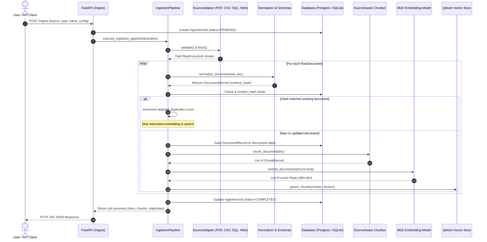
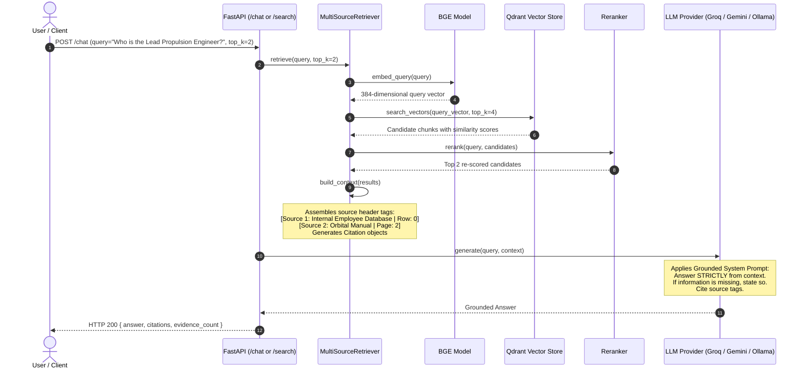

# Multi-Source RAG — End-to-End System Flow

This document details the complete end-to-end data and execution flows across all stages of the application.

---

## 1. Global Pipeline Architecture

```
[ Data Source ] 
       │
       ▼
1. FETCH (app/sources/)
       │
       ▼
2. EXTRACT (app/extraction/) ──> (OCR Fallback if scanned page)
       │
       ▼
3. NORMALIZE (app/normalization/) ──> Clean Unicode / Whitespace / Schema Drift
       │
       ▼
4. DEDUPLICATE (app/database/) ──> Compute SHA-256 (Skip unchanged docs)
       │
       ▼
5. CHUNK (app/chunking/) ──> Source-Aware Boundary Splitting
       │
       ▼
6. EMBED (app/embeddings/) ──> Local BGE Model Batching
       │
       ▼
7. UPSERT (app/vectorstore/) ──> Deterministic Point ID Upsert into Qdrant
       │
       ▼
8. CHECKPOINT (app/database/) ──> Mark Job COMPLETED
```

---

## 2. Ingestion Flow (Step-by-Step)



---

## 3. Specialized Extraction Flows

### A. PDF Extraction & OCR Fallback Flow
```
PDF File
   │
   ▼
Open via PyMuPDF (fitz)
   │
   ├─► For each page:
   │      │
   │      ├─► Extract text layer: `text = page.get_text()`
   │      │
   │      ├─► Evaluate: `len(text.strip()) < 20`?
   │      │      │
   │      │      ├─► NO (Native Text):
   │      │      │     Keep extracted text, `ocr_used = False`
   │      │      │
   │      │      └─► YES (Scanned / Image-Only):
   │      │            Render page pixmap (`page.get_pixmap()`)
   │      │            Convert to PNG image bytes
   │      │            Invoke Tesseract OCR engine (`pytesseract`)
   │      │            Recover text, set `ocr_used = True`
   │      │
   │      └─► Store page metadata (page_number, char_count, ocr_used)
   │
   ▼
Yield RawDocument with embedded page boundaries
```

### B. Tabular Schema Drift Flow (CSV / SQL / JSON)
```
Raw Row Dict: {'emp_id': 101, 'full_name': 'Alice', 'dept': 'Eng', 'clearance': 'TopSecret'}
   │
   ▼
normalize_record_schema()
   │
   ├─► Known Aliases (CANONICAL_ALIASES):
   │      'emp_id'    ──► 'id': 101
   │      'full_name' ──► 'name': 'Alice'
   │      'dept'      ──► 'department': 'Eng'
   │
   ├─► Unknown / Unexpected Fields:
   │      'clearance' ──► extra_metadata: {'clearance': 'TopSecret'}
   │      (Ingestion does not crash; extra metadata preserved)
   │
   └─► Fingerprint:
          SHA-256 of sorted keys ──► schema_hash: '9a8b7c6d5e4f'
```

---

## 4. Retrieval & Grounded RAG Flow



---

## 5. Resilience & Failure Handling Flow (DLQ)

```
Pipeline Execution
       │
       ▼
Error Encountered?
       │
       ├─► Transient Network / 429 / 5xx / Timeout:
       │      │
       │      └─► Tenacity Exponential Backoff:
       │            Attempt 1: wait 0.5s
       │            Attempt 2: wait 1.0s
       │            Attempt 3: wait 2.0s
       │            Retry operation
       │
       └─► Permanent Failure (Corrupt File / Auth Error / Max Retries Exceeded):
              │
              ├─► Trap Typed Error (`ExtractionError`, `PDFExtractionError`, etc.)
              │
              ├─► Route to Dead-Letter Queue:
              │     Persist into `failed_documents` table:
              │     - `failure_id`
              │     - `job_id`
              │     - `stage` (FETCH / EXTRACT / NORMALIZE / EMBED)
              │     - `error_code` (e.g. 'PDF_CORRUPT')
              │     - `error_message`
              │     - `raw_payload`
              │
              └─► Mark `ingestion_jobs` status as `FAILED` or `DEAD_LETTER`
```
